<div align="center">

# FORGE®

### Industrial Intelligence & Operations Platform

**ENGINEERED FOR WHAT'S NEXT.**

A complete, multi-page enterprise application for manufacturing operations — MES, ERP, IIoT monitoring, a 3D factory digital twin, planning, inventory, quality, maintenance and analytics — running on a deterministic simulated factory network.

**[Live demo → https://forge-platform-liart.vercel.app](https://forge-platform-liart.vercel.app)**

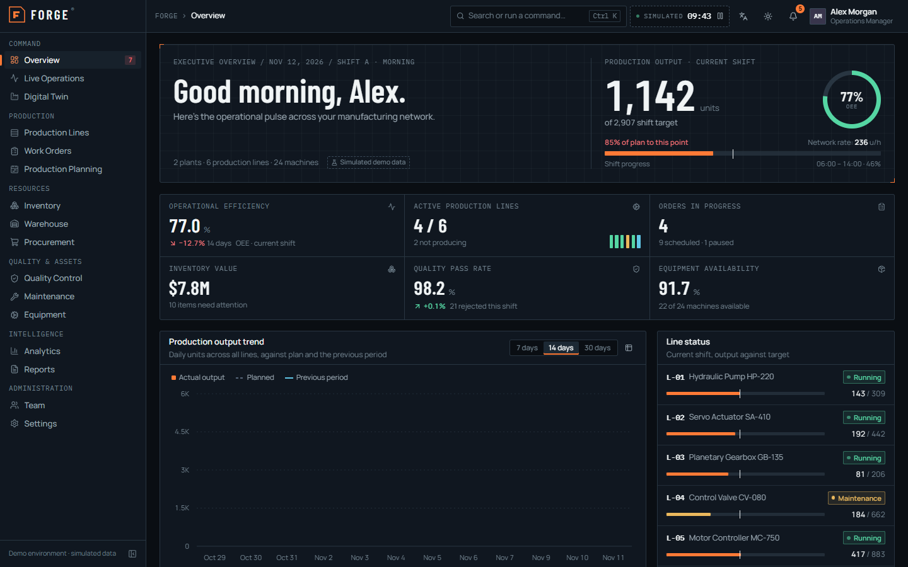

</div>

> **Everything here is simulated.** FORGE is a portfolio demonstration. All plants, machines, suppliers, people and figures are fictional, and no real equipment, sensor or external system is connected. "Live" values come from a deterministic local simulation that is labelled as such throughout the interface.

---

## What's inside

| Area | Routes | Highlights |
|---|---|---|
| **Command** | `/overview` · `/operations` · `/factory` | Executive command center, live operations monitor, interactive 3D digital twin with a 2D fallback |
| **Production** | `/production` · `/production/[id]` · `/work-orders` · `/work-orders/[id]` · `/planning` | Line control, full work-order lifecycle, Gantt scheduling with conflict detection and keyboard-accessible rescheduling |
| **Resources** | `/inventory` · `/inventory/[id]` · `/warehouse` · `/warehouse/[id]` · `/procurement` · `/suppliers/[id]` | Stock adjustments with threshold alerts, interactive warehouse zone maps, purchase approvals and goods receipt |
| **Quality & Assets** | `/quality` · `/quality/[id]` · `/maintenance` · `/equipment` · `/equipment/[id]` | Inspections and corrective actions, maintenance work orders, equipment registry with simulated telemetry |
| **Intelligence** | `/analytics` · `/reports` | OEE, downtime, quality and inventory analytics; seven reports with real CSV export and print view |
| **Administration** | `/team` · `/settings` | Role-aware demo interface with a role switcher, preferences, demo-data reset |

Plus a global command palette (`Ctrl/⌘ + K`), a notification centre with activity history, English and Arabic (full RTL), and dark and light themes.

## Screenshots

| | |
|---|---|
| 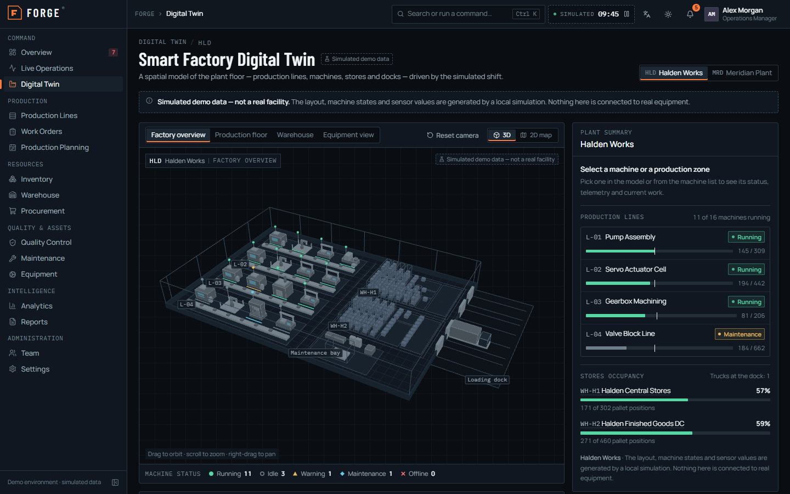 **Smart factory digital twin** | 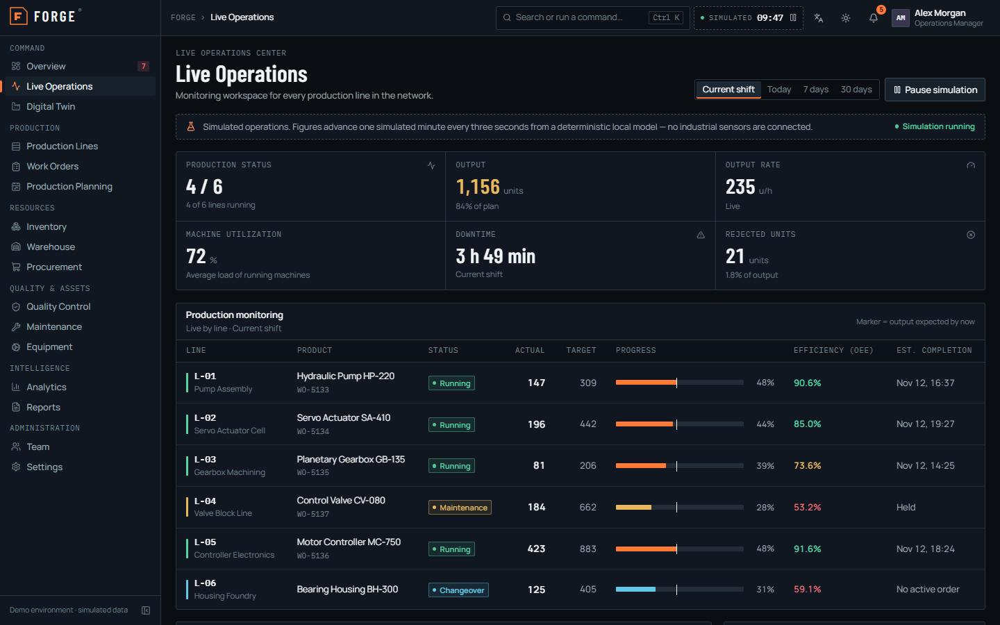 **Live operations center** |
| 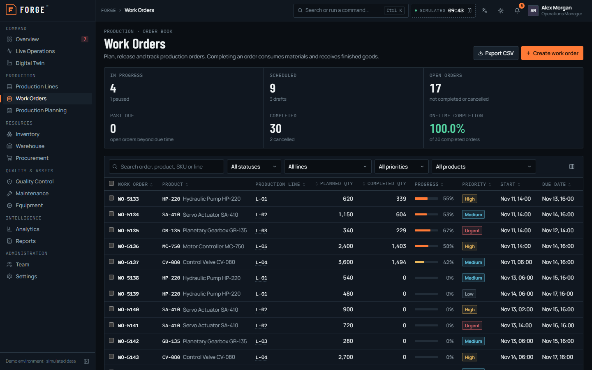 **Work orders** | 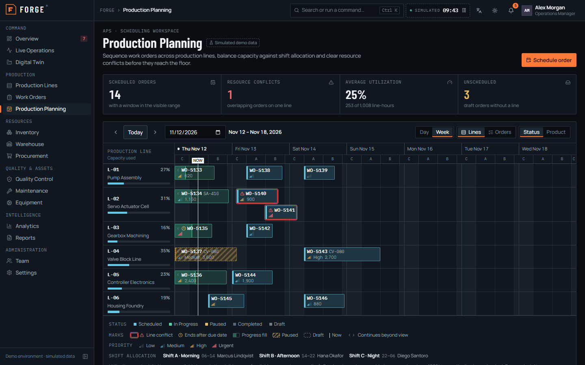 **Production planning** |
| 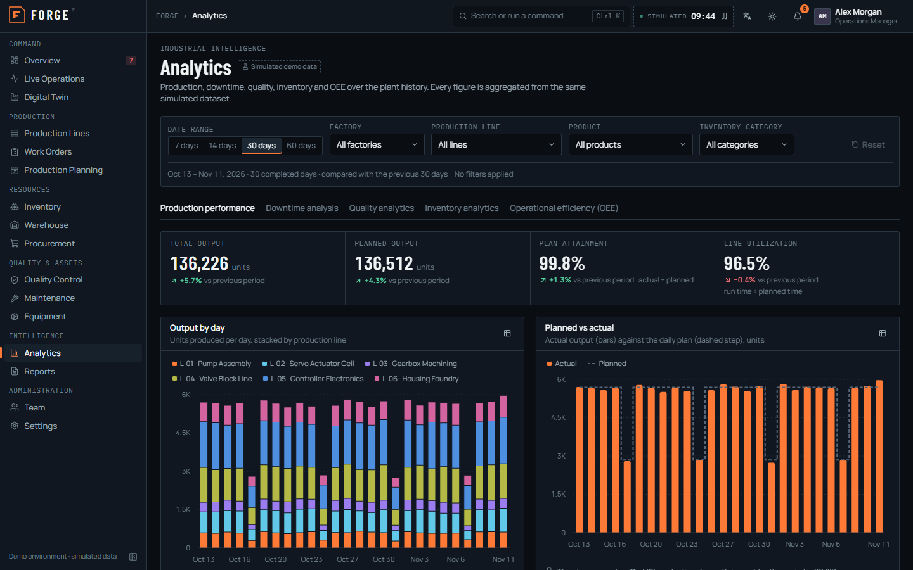 **Analytics & OEE** | 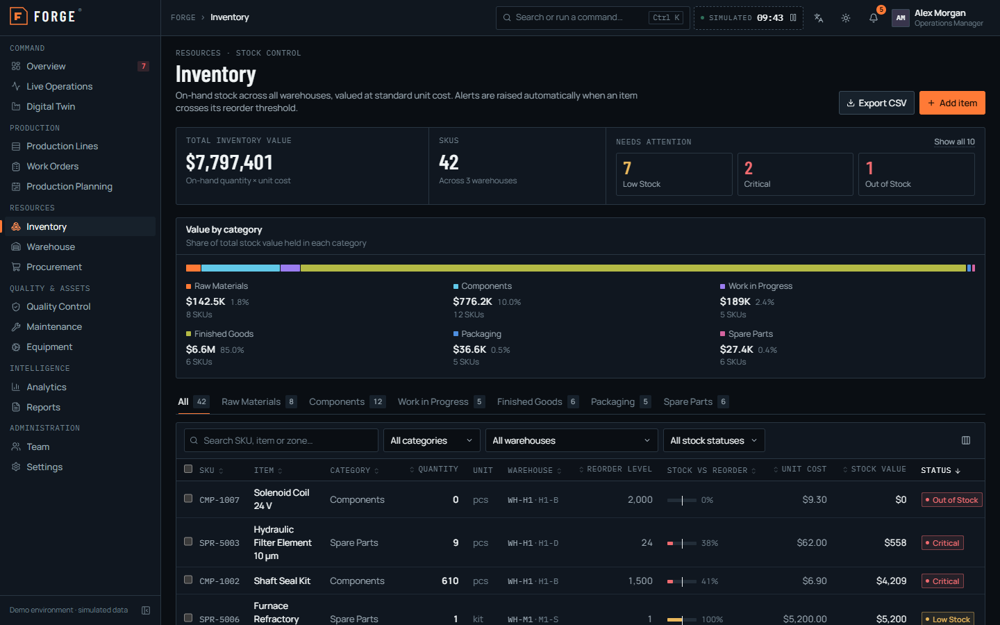 **Inventory** |
| 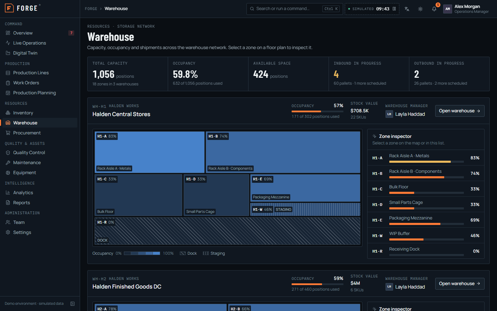 **Warehouse zone map** | 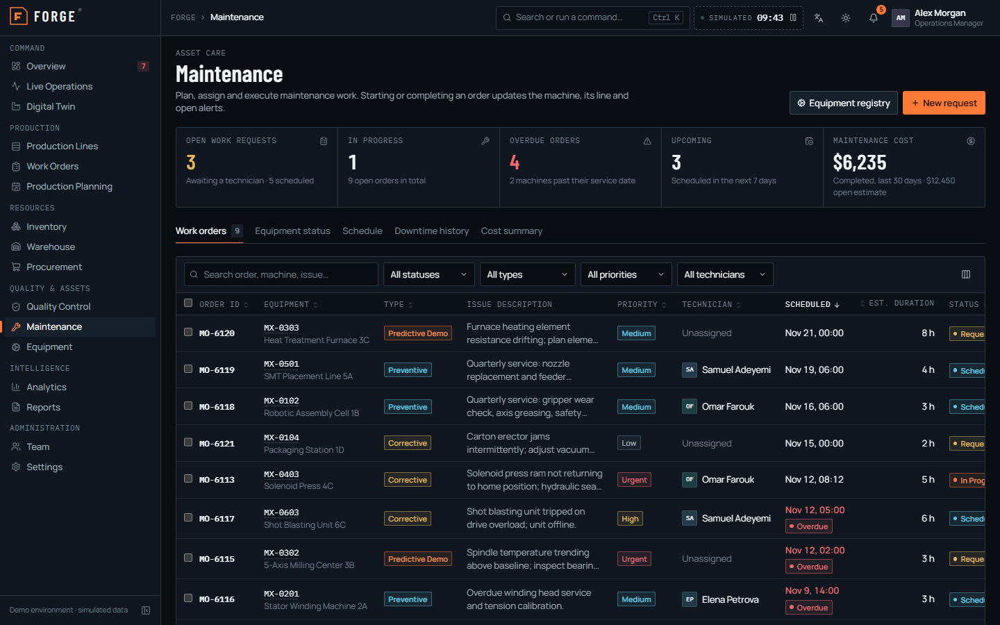 **Maintenance** |
| 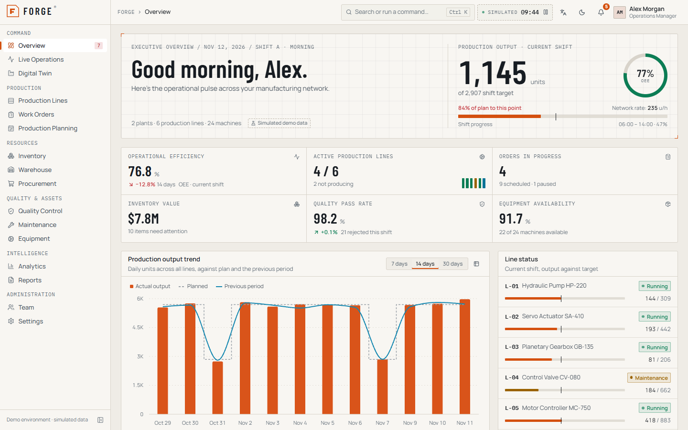 **Light theme** | 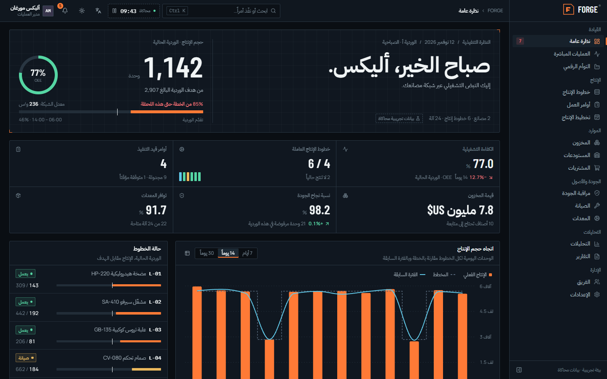 **Arabic · RTL** |

<p align="center">
  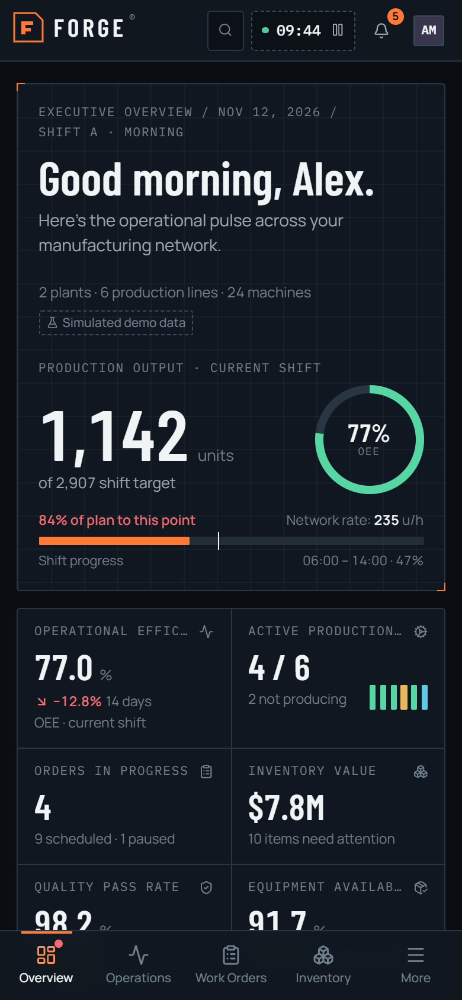
  &nbsp;&nbsp;
  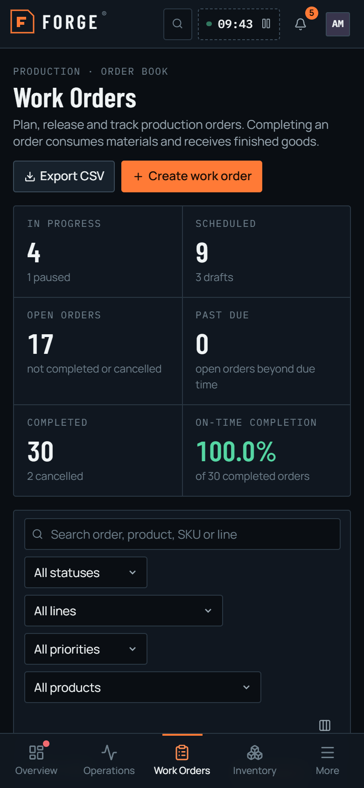
  &nbsp;&nbsp;
  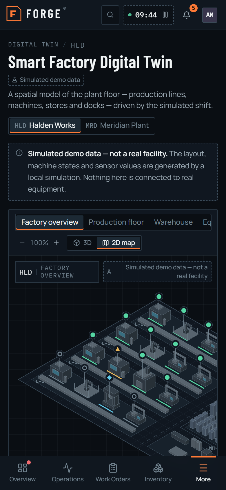
</p>

## The data engine

One store is the single source of truth, and every change goes through an action that runs the cascades keeping modules consistent:

- **Completing a work order** backflushes materials from inventory per the product's bill of materials, receives the good units into finished goods, frees the production line, raises stock alerts if a threshold is crossed, and logs the event.
- **Adjusting stock** records a movement, recalculates value and status, and raises or resolves inventory alerts. Stock cannot go negative unless an explicit supported reason is given.
- **Starting maintenance** takes the machine down, stops its line and pauses the running order; **completing it** restores the machine, resets the service schedule and resolves related alerts.
- **Recording an inspection** computes the outcome against the release limits, links to its work order, and raises a quality alert on failure.

The dataset is generated from a fixed seed anchored to a simulated clock (no `Math.random`, no wall-clock reads in business logic), so every figure is reproducible. OEE is always aggregated from raw inputs — Availability × Performance × Quality — never averaged from percentages. A consistency script verifies referential integrity and invariants:

```bash
npm run check:data        # referential integrity and dataset invariants
npm run check:workflows   # 190 assertions against the real store: lifecycles, cascades, determinism
```

See [`docs/ARCHITECTURE.md`](docs/ARCHITECTURE.md) for structure and conventions.

## Tech stack

Next.js 16 (App Router) · React 19 · TypeScript (strict) · Tailwind CSS 4 · Zustand · Recharts · three.js / React Three Fiber · Motion · Lucide · Zod

## Run it locally

```bash
npm install
npm run dev        # http://localhost:3000
```

```bash
npm run build      # production build
npm run typecheck  # TypeScript
npm run lint       # ESLint
```

State is kept in your browser's `localStorage`. **Settings → Reset demo data** restores the original dataset.

## Design system

A dark-first industrial identity built on semantic tokens — graphite surfaces, hairline borders, sharp 2–4 px radii, IBM Plex Mono for identifiers, a condensed display face for headline figures, and Forge orange reserved for the active thing. The light theme is separately art-directed on warm industrial white rather than inverted. Arabic uses IBM Plex Sans Arabic with full layout mirroring, while identifiers and codes always stay left-to-right.

## Notes

- The role model changes which actions the interface offers. It is a demonstration, **not** a security boundary.
- Predictive-maintenance indicators are transparent demo calculations, not AI predictions.
- No supplier is contacted and nothing is sent to any external system.
